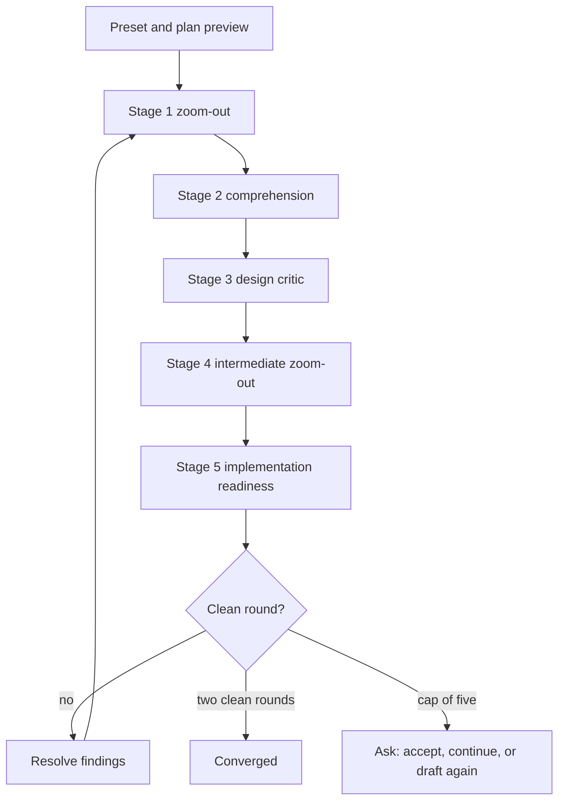

# 03 Review and resolve

The review engine is the heart of the stack. A reviewer with no history sees
what the author stopped seeing.

## Profiles

A profile picks the standards and the questions. It never forks the engine.

| Profile | Use it for |
| --- | --- |
| `concept` | A concept brief, before drafting |
| `spec` | A design draft |
| `plan` | A multi-phase plan |
| `doc` | Human documentation |
| `code` | A diff or a branch |
| `ddd` | A domain model and its boundaries |
| `comments` | Comment cleanup and workaround code |

## Stages

Five stages run in order. Each stage writes its report before the next stage
starts. A later stage never sees an earlier stage's report as its input.

| Stage | Report | What it asks |
| --- | --- | --- |
| 1. Zoom-Out plus Inventive Catalyst | `review/01-zoom-out.md` | Is this the right problem, and what would a better answer look like |
| 2. Comprehension | `review/02-comprehension.md` | Can a reader follow this without the author |
| 3. Design Critic | `review/03-design-critic.md` | What breaks, what is missing, what is overbuilt |
| 4. Intermediate Zoom-Out | `review/04-intermediate-zoom-out.md` | Does the whole still hold together after the critique |
| 5. Implementation Readiness | `review/05-readiness.md` | Can an engineer build this without asking a question |

The stage table is generated into
[getting_started.md](../getting_started.md). It is the shared map.

## Fresh context

Fresh context is mandatory. A reviewer never sees the drafting history, the
parent chat, or another reviewer's answer. Each reviewer gets the artifact, the
standard, the persona, and an exact scope. Nothing else.

On a host with no subagent tool, the run stops. It does not review its own
draft in the same context. That rule has no exception, because a review by the
author is not a review.

Reviewers are read-only. Only the parent or the synthesizer writes a report.

## The loop

Loop mode repeats rounds until the work is clean or the cap is reached.

- A clean round has no unsettled Blocker and no unsettled Major.
- Converged means two consecutive clean rounds.
- The cap is five rounds.
- A settled finding never re-opens.
- An applied fix does not settle a finding by itself. It needs a passing
  re-check.
- A reviewer that did not run makes the round unclean.
- Repeated churn is detected and ends the loop with a report instead of another
  round.

## Gates

A gate is one question. It is the only tool call in that turn. The agent yields
immediately after asking. It never prefixes an option with a recommendation.

A gate is how the human keeps authority over trade-offs. The agent does not
answer its own gate, and neither does another skill.

## Reports

Two reports matter.

- `goldfish_review_report.md` is the round report. It lists every finding, its
  severity, and the round state.
- `consolidated_review_report.md` is the single report a human reads. It
  carries `Status:` and `**Target:**`. Resolve and ask read those two lines.

## Resolve

```text
/egm-resolve
```

Resolve triages each finding into one of three buckets.

- Fix now. Apply the smallest root-cause fix and re-check.
- Accept with a note. Record why the finding does not apply.
- Defer with an owner. Record the follow-up and the reason.

Approved fixes are the only edits. Resolve does not widen the scope, and it
does not quietly rewrite the design. A fix that needs a design change goes back
to draft with your approval.

## The flow



The plan preview prints stages, reviewers, spawns per round, and the round cap
before the first reviewer starts.

## Converge

When the loop converges, promote the spec. Copy `design_draft.md` to
`docs/designs/<slug>.md`, set `Status: Current`, and add a row to
[designs/README.md](../designs/README.md). The `.egm/` trail stays where it is.

## Next

[04-deliver.md](04-deliver.md) carries the approved design to a verified
change.
