# Skill dependency graph

Generated by `scripts/skill-graph.mjs`. Do not edit by hand.

- Skills: 48
- Edges: 55
- Cycles: 0
- Dangling references: 0

## Graph

```mermaid
graph LR
  arena --> delegate
  egm-brainstorm --> delegate
  egm-mode --> arena
  egm-mode --> ddd
  egm-mode --> delegate
  egm-mode --> egm-brainstorm
  egm-mode --> egm-draft
  egm-mode --> egm-drift
  egm-mode --> egm-resolve
  egm-mode --> egm-review
  egm-mode --> how
  egm-mode --> no-comments
  egm-mode --> principle-attack-the-premise
  egm-mode --> principle-boundary-discipline
  egm-mode --> principle-build-the-lever
  egm-mode --> principle-encode-lessons-in-structure
  egm-mode --> principle-exhaust-the-design-space
  egm-mode --> principle-experience-first
  egm-mode --> principle-explain-the-number
  egm-mode --> principle-fix-root-causes
  egm-mode --> principle-foundational-thinking
  egm-mode --> principle-guard-the-context-window
  egm-mode --> principle-laziness-protocol
  egm-mode --> principle-make-operations-idempotent
  egm-mode --> principle-migrate-callers-then-delete-legacy-apis
  egm-mode --> principle-minimize-reader-load
  egm-mode --> principle-model-the-domain
  egm-mode --> principle-never-block-on-the-human
  egm-mode --> principle-outcome-oriented-execution
  egm-mode --> principle-prove-it-works
  egm-mode --> principle-redesign-from-first-principles
  egm-mode --> principle-separate-before-serializing-shared-state
  egm-mode --> principle-sequence-verifiable-units
  egm-mode --> principle-subtract-before-you-add
  egm-mode --> principle-test-behavior-not-implementation
  egm-mode --> principle-type-system-discipline
  egm-mode --> rules
  egm-mode --> statechart
  egm-mode --> ste100
  egm-mode --> tdd
  egm-mode --> technical-writing
  egm-mode --> unslop
  egm-mode --> why
  egm-resolve --> delegate
  egm-review --> delegate
  egm-review --> egm-resolve
  egm-verify --> delegate
  how --> delegate
  no-comments --> delegate
  reflect --> delegate
  ste100 --> unslop
  swarm --> delegate
  technical-writing --> ste100
  technical-writing --> unslop
  why --> delegate
```

## Cycles

None.

## Dangling references

None.
